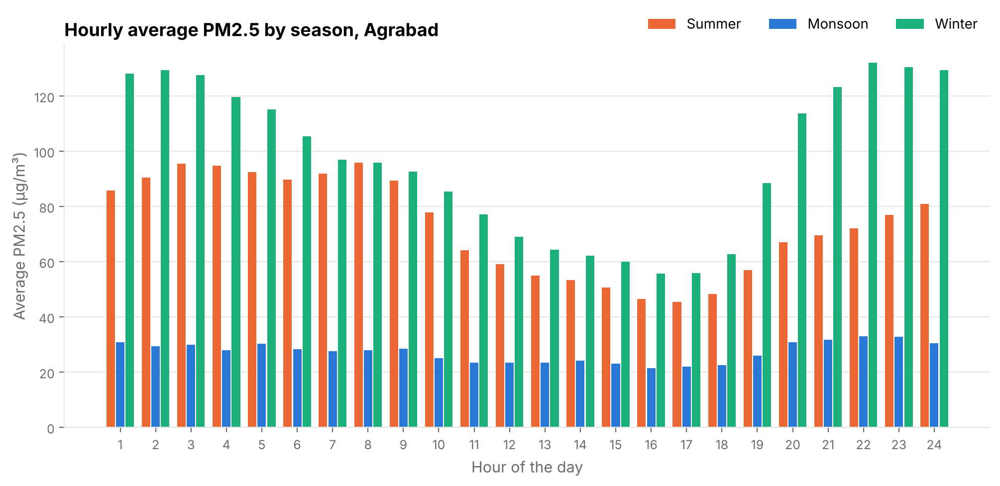
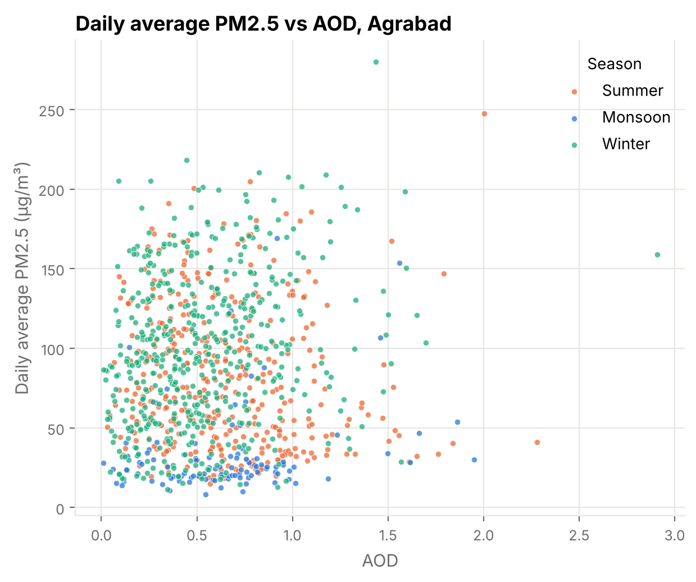

# Hourly PM2.5 Imputation from Satellite AOD (Chittagong)

Air quality monitoring stations in Bangladesh have a lot of missing hourly data because of
maintenance downtime and load-shedding. Between 2014 and 2021, 53% of the hours are missing
at the Agrabad CAMS station and 72% at Khulshi.

In this project I used daily satellite AOD, temperature and rainfall with a SARIMAX model to
reconstruct the missing hourly PM2.5 for 2014-2021. I also checked whether a model trained at
Agrabad can predict PM2.5 at Khulshi without retraining (spatial transferability).

## Method

1. **Preprocessing:** Hourly CAMS records were pivoted so that each row is one day with 24
   hourly PM2.5 columns. Temperature and rainfall were averaged per day. This was merged with
   daily AOD for 2,922 days (2014-01-01 to 2021-12-31).
2. **Missing inputs:** Missing AOD and temperature were filled with linear interpolation;
   missing rainfall was set to 0.
3. **Seasonal hourly profiles:** For each season (Summer: Feb-May, Monsoon: Jun-Sep,
   Winter: Oct-Jan), the average PM2.5 of each hour was divided by the average of the whole
   day. This gives 24 hourly ratios per season.
4. **Model:** SARIMAX(1,0,1) with daily average PM2.5 as the target and AOD, temperature and
   rainfall as exogenous variables (Box & Jenkins, 1970).
5. **Hourly PM2.5:** predicted daily average × hourly ratio of that season. Only the missing
   hours are filled; observed values are not changed.
6. **Spatial transferability:** The model fitted at Agrabad was applied to Khulshi's AOD and
   weather data without refitting, using Agrabad's hourly ratios. The predicted hours were
   compared with Khulshi's observed hours.



## Results

| Station | | Hourly R² | Hourly MAPE | Observed hours | Imputed hours |
|---|---|---:|---:|---:|---:|
| Agrabad | training | 0.580 | 51.3% | 32,952 | 37,176 |
| Khulshi | transfer | 0.530 | 58.6% | 19,628 | 50,500 |

The model trained at Agrabad still gives R² above 0.5 at Khulshi without refitting.

Model coefficients (Agrabad): AOD 7.80, temperature -3.02, rain -0.63, AR(1) 0.995,
MA(1) -0.360. See `results/metrics.json`.



### Limitations

- AR(1) is 0.995, so the prediction depends a lot on the previous day's PM2.5. The same-day
  correlation between daily PM2.5 and AOD is weak (r = 0.045 at Agrabad, 0.103 at Khulshi).
- Agrabad is evaluated on the same data used for fitting (no hold-out period).
- For Khulshi, the model uses Khulshi's own observed daily PM2.5 history when predicting,
  so it is not a satellite-only prediction.
- AOD is missing on 43% of days at Agrabad (77% of monsoon days) and these gaps are
  interpolated. Khulshi has temperature missing on 2,036 days and rainfall on 2,427 days.
- At Agrabad winter is the most polluted season, while at Khulshi it is summer, but Khulshi
  uses Agrabad's hourly ratios.

Next steps: a time-based hold-out test (train 2014-2019, test 2020-2021) and testing on
other CAMS stations.

## Data

| File | Description |
|---|---|
| `data/raw/aod_daily_2014_2021.csv` | Daily AOD at 10 CAMS locations (`Time` is dd-mm-yyyy) |
| `data/raw/station_locations.csv` | Coordinates of the CAMS stations |
| `data/processed/agrabad_daily.csv` | Agrabad observed data, one row per day (`Date`, hours `1`-`24`, `Temperature`, `Rain`) |
| `data/processed/khulshi_daily.csv` | Same for Khulshi |

PM2.5 (µg/m³), temperature and rainfall are from the Bangladesh Department of Environment
(DoE) Continuous Air Monitoring Stations: Agrabad and TV Station Khulshi, Chittagong.


The processed files contain observed values only. In the original export, dates from July 2019
onward include a time, so they were converted to one row per day. On 3 Sep, 3 Oct and 3 Nov
2019 Khulshi has two different PM2.5 values for the same hour (54 hours in total); these
hours were left missing.

The raw DoE CAMS workbook is not included. If you have it, you can run from it directly
(sheets `Agrabad Chittagong` and `TV st-Chittagong`).

## How to run

```bash
pip install -r requirements.txt
python main.py
```

or from the DoE workbook:

```bash
python main.py --excel "DoE CAMS Air Quality Data.xlsx"
```

Outputs go to `results/`:

- `<Station>_PM2.5_Imputed_Dataset.csv`: Date, AOD, hours 1-24, Temperature, Rain with no missing hours
- `<Station>_imputation_flags.csv`: `True` where a value was filled (PM2.5 hours, AOD, temperature, rain)
- `metrics.json`: R², MAPE and model coefficients
- `figures/`

## Project structure

```
├── main.py
├── src/
│   ├── config.py
│   ├── preprocessing.py
│   ├── seasonal.py
│   ├── model.py
│   └── plots.py
├── data/
│   ├── raw/
│   └── processed/
└── results/
```

## Reference

Box, G. E. P., & Jenkins, G. M. (1970). *Time Series Analysis: Forecasting and Control.* Holden-Day.

## Author

Sadman Sakib, Civil Engineering, CUET
